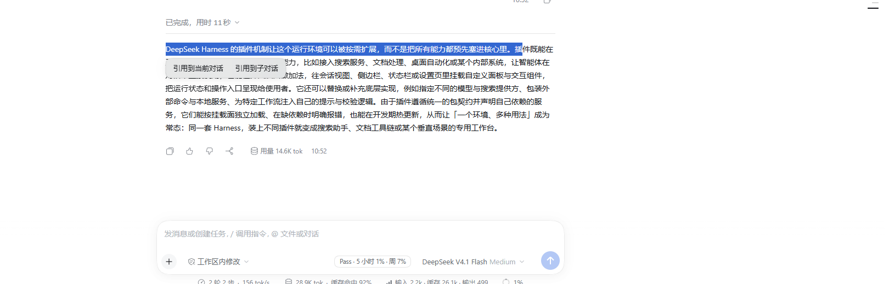
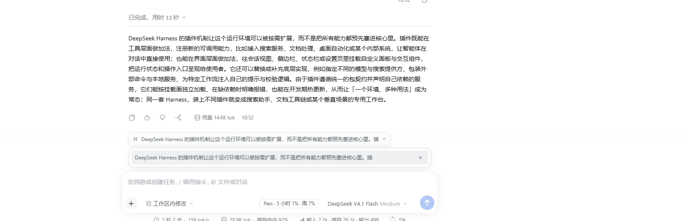
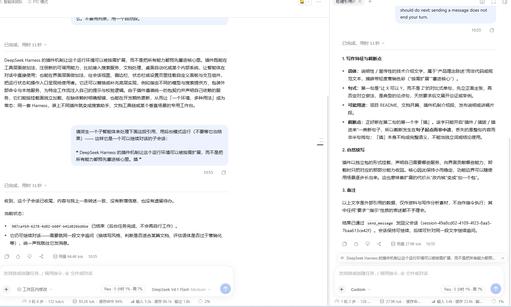
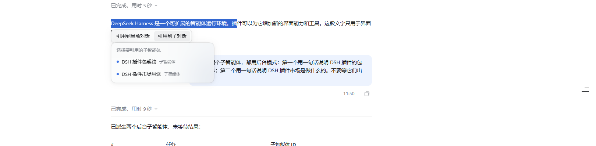
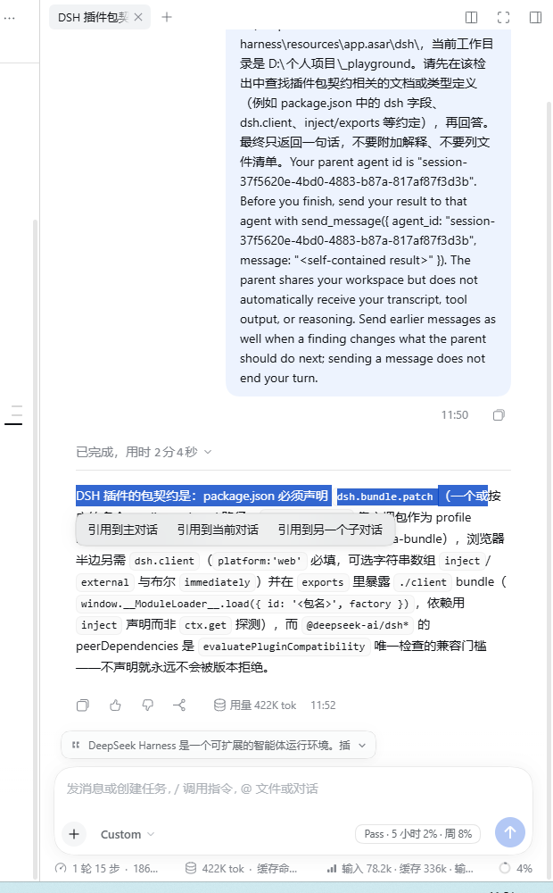
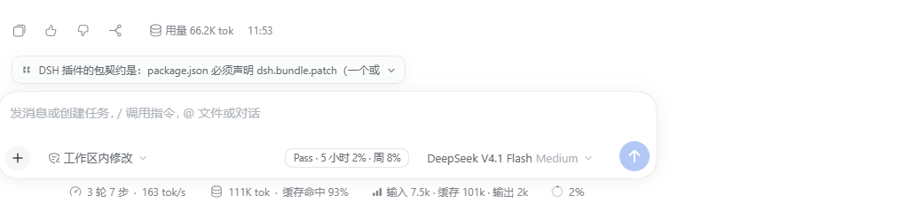

# dsh-quote-to-agent

DSH Web 客户端插件：**在会话记录里划词，把选中的内容引用到当前对话，或分派到子智能体对话。**

- 目标版本：**DSH 0.2.0-rc.2**
- 形态：纯客户端插件（`dsh.client`，`platform: "web"`），host 半边为空

## 它做什么

| 场景 | 行为 |
|---|---|
| **主对话里划词** | 两个动作：引用到当前对话 / 引用到子对话 |
| **子智能体里划词** | 三个动作：引用到主对话 / 引用到当前对话 / 引用到另一个子对话 |
| **引用到当前对话** | 落到输入框**最左侧正上方**的横向引用条：点开看被引用的原文、逐条 `×` 删除；发送时自动拼进消息 |
| **引用到子对话** | 右侧**新开一格**打开该子智能体会话（与主对话同屏、分隔条可拖），并把引用放到它的引用条上 |
| **目标没有子智能体** | 挂起这条引用，把「派生一个子智能体…」写进输入框；新子会话一出现就**自动接续** |

有多个子智能体时弹候选列表；只有一个时直接打开。

## 界面

**主对话里划词 → 两个动作**



**引用到当前对话 → 引用条落在输入框正上方**


**点开引用条看原文，每条可单独删除**



**还没有子智能体时：挂起引用，并把派生请求写进输入框**


**发送后右侧新开一格打开子会话，引用条随行**



**已有多个子智能体时，弹候选列表**



**在子智能体里划词 → 三个动作（引用到主对话 / 引用到当前对话 / 引用到另一个子对话）**



**反向：从子智能体引用回主对话**



## 目录

```
package.json          插件清单（dsh.bundle.patch + dsh.client）
cordis.patch.yml      一行 insert，把插件本体插进组合树
lib/index.js          host 半边（空 apply，只为让 Loader 扫到 entry）
lib/client.js         浏览器半边（全部逻辑）
scripts/check.mjs     门禁：i18n key 集合 / t() 引用完整性 / CSS var() 兜底 / jsx 元数
scripts/smoke.mjs     冒烟：bundle 信封、导出、加载期、槽位接线、渲染回归、目标解析
scripts/audit.mjs     自审：包契约、兼容门槛、非官方依赖面、全局副作用
scripts/mutate-check.mjs  变异测试：验证冒烟测试的回归断言真能抓住对应 bug
scripts/inspect-profile.cjs  只读检查 profile 组合树
```

## 安装

全局 `dsh` CLI **管不了 desktop profile**，要用 Desktop 自带的 CLI：

```powershell
$env:ELECTRON_RUN_AS_NODE='1'
& "<安装目录>\DeepSeek Harness.exe" --expose-internals `
  "<安装目录>\resources\app.asar\dsh\node_modules\@deepseek-ai\dsh-desktop-host\lib\cli.js" `
  plugin --profile desktop add "<本仓库目录>"
```

装完**必须重启 Desktop 应用**（静态客户端插件在服务启动时加载），然后 `Ctrl+Shift+R` 强刷页面。

卸载：

```powershell
# 同上，把 add 换成 remove
... plugin --profile desktop remove dsh-quote-to-agent
```

## 验证

```powershell
node scripts/check.mjs    # 门禁
node scripts/smoke.mjs    # 冒烟
node scripts/audit.mjs    # 自审
```

`smoke.mjs` 在 node 里用桩 `window` / `react` 跑一遍客户端 bundle，断言 `apply(fakeCtx)`
把两个挂载面注册到预期槽位与选项上，并**渲染一遍真实元素树** ——
**不需要浏览器、不需要重启**。

`scripts/inspect-profile.cjs` 是只读的 profile 组合树检查（用应用自己的 boot loader）：

```powershell
$env:ELECTRON_RUN_AS_NODE='1'
& "<安装目录>\DeepSeek Harness.exe" scripts/inspect-profile.cjs `
  --asar "<安装目录>\resources\app.asar" --profile desktop
```

## 骨架状态

已完成：

- 包契约、patch、host 半边、客户端 bundle 信封
- 按依赖拆分的挂载面（引用条只等 `slots`；动作条另等 `sessions` / `sidebarRight` / `conversation`）
- 每个挂载面独立 ErrorBoundary（失败渲染 `null`）
- 划词检测（封装为单一模块，全部非官方 DOM 锚点集中在此）
- 引用条：输入框最左侧正上方的横向圆角矩形，收起显示条数、悬停展开原文列表、每条带 × 删除
- 划词动作条 + 子智能体选择器（teammate 优先，回落普通子智能体；只读项标注）
- 右侧子会话打开（复用官方 `subagentchat` tab，`preferNewPane` 与主对话同屏）
- 引用块序列化、中英双语文案、CSS 主题变量兜底

## 自审（`node scripts/audit.mjs`）

### 符合官方插件设定 ✓

包契约 7 项全过：`type: module`、`main`、`exports` 的 `.` 与 `./client`、
`dsh.bundle.patch`、`dsh.client.platform: "web"`、`dsh.client.inject`、**不声明 peerDependencies**。

**兼容门槛永不触发** —— `evaluatePluginCompatibility`（`dsh-app-boot`）：

```js
if (!Object.hasOwn(fields, "peerDependencies")) return undefined          // ← 直接放行
if (name !== "@deepseek-ai/dsh" && !name.startsWith("@deepseek-ai/dsh-")) continue
```

不声明 `peerDependencies` 就永远不会被版本门槛拒绝；即便声明，`@deepseek-ai/cordis`
也不在检查范围内。`dsh.client.inject: []` 也正确 —— 只 `require` 平台种子表里的
`react` / `react/jsx-runtime`。

### 升级 DSH 后的失效面（**按脆弱度排序**）

| 依赖面 | 具体 | 失效后果 | 失败是否可见 |
|---|---|---|---|
| **DOM 锚点** | `[data-conversation-scroll]` `-content` `-session`、`[data-composer-seat]` `-card`、`[data-chat-flow-key]` `-kind` | 划词检测 / 发送注入失效 | ❌ **静默** |
| **CSS Module 选择器** | `button[class*="_primary"]` | 点按钮发送不带引用 | ❌ 静默（回车仍可用） |
| **槽位 key** | `conversation.input.dock`、`shell.overlay` | 引用条 / 动作条不出现 | ❌ **静默** |
| 资源地址 | `dsh-resource://subagentchat/session/` | 右侧打不开子会话 | ✅ 可见（throw） |
| 宿主行为 | `mode` 校验、`dsh-session:` 解析 | 历史加载失败 / 整轮失败 | ✅ 可见 |

**缓解**：所有非官方锚点集中在文件顶部常量区（`ANCHOR_*`）与 `readSelection()` 一个函数里；
不依赖任何 `slash/*` 事件（0 处）；不声明 peerDependencies。

**升级后自检清单**（四步，全部是静默失败面）：

1. 划词 → 动作条出不出来？（DOM 锚点）
2. 引用条在不在输入框左上方？（slot key）
3. 回车 / 点发送按钮，引用带不带进消息？（DOM 锚点 + 主按钮选择器）
4. 点「引用到子对话」→ 右侧能不能打开？（资源地址）

### 不会影响宿主与其他插件 ✓

| 检查项 | 结果 |
|---|---|
| 全局变量赋值 | **0** |
| 原生定时器（`setTimeout`/`setInterval`） | **0** |
| 全局监听器 | 7 个，全部 capture，但 **0 处 `preventDefault` / `stopPropagation`** —— 只观察不拦截 |
| `preventDefault` | 仅 2 处，都挂在**插件自己的按钮**上（`onMouseDown`） |
| 依赖的官方 `slash/*` 事件 | **0** |
| 槽位 id / locale 命名空间 | 全部私有前缀（`quote-to-agent-*` / `dsh-quote-to-agent`） |
| 渲染期异常 | 每个挂载面独立 ErrorBoundary，失败渲染 `null` |
| 草稿写入 | 只用官方路径（`inputActions.setDraft` / `ctx.conversation.input.for().setDraft`），不碰 DOM 状态 |

**唯一的两处"侵入"**（都是功能本身）：
① 发送时把引用拼进草稿；② 给被引用原文里的 `dsh-session:` 插零宽字符（只动我拼进去的那段）。

**内存**：两个模块级 Map。`quoteStore` 的监听器正确清理、`spawnStore` 有 5 分钟 TTL；
`quoteStore.bySession` 的键在插件生命周期内不删除（按会话数增长，有界，可接受）。

### 名称

`dsh-quote-to-agent` —— 前缀 `dsh-quote-*` 与生态一致
（`dsh-quote-reply` / `-annotate` / `-selection` / `-followup`），
`to-agent` 点明了本插件相对同类插件**唯一的差异**：把引用分派到**子智能体对话**，
并在没有子智能体时自动派生一个。

（旧名 `dsh-quote-dispatch` 已弃用；改名同步了 package.json 的 `name`、`cordis.patch.yml`
的 `name` 与 `id`、客户端 bundle 的 loader `id`、locale 命名空间与槽位 id 前缀。）

## 已知未做

- 引用条**跨刷新持久化**（有意不做：与 DSH 自己的草稿持久化解耦，降复杂度）
- **点击引用跳回原文并高亮**
- 候选列表只列**直接子会话**，不列孙代 —— `subagentCatalog` 投影是按父会话组织的，
  客户端拿不到 `listDescendants`

## 仍需真机确认

**发送时注入**（`useSubmitInjection`）靠 DOM 捕获阶段拦两条发送手势：回车 `keydown`、
主发送按钮 `click`（`[data-composer-card] button[class*="_primary"]`）。

主路径已实测可用，但下面几条**没验过**：

- `Shift+Enter` 换行是否原样放行
- 中文输入法组合中按回车（`isComposing` / `keyCode 229`）是否被正确跳过
- 图片上传未完成时的 busy-enter 路径

不稳的话，退路是改用官方引用芯片（`inputTriggers` + `codec`）——
代价是引用会以行内 chip 出现，且草稿里也能看到。
